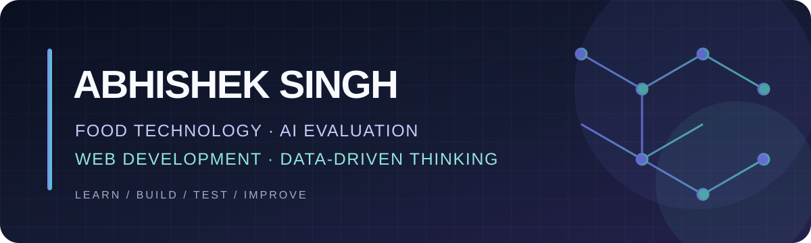
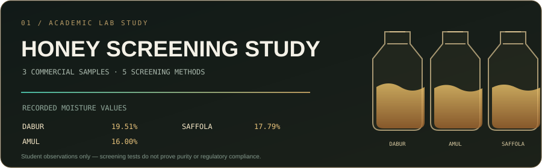
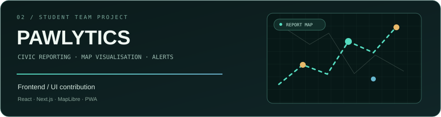

<div align="center">



<br/>

[](https://github.com/abhishek-singh-devs)

[](https://github.com/abhishek-singh-devs)


</div>

<br/>

## `01 // PROFILE`

I’m **Abhishek Singh**, a B.Tech Food Technology student at **IILM University, Greater Noida**. My background sits between **food quality, dairy operations, data handling, and technology-led problem solving**.

I’ve worked with quality checks in a dairy production environment and contributed frontend/UI work to a student civic-tech project. I’m now developing stronger skills in **web application testing and AI response evaluation**.


## `02 // SYSTEM PROFILE`

<div align="center">

</div>

| Field | Snapshot |
|---|---|
| 🎓 **Education** | B.Tech Food Technology · IILM University |
| 🧪 **Industry exposure** | Quality Assurance & Production · Jaipur Dairy (SARAS) |
| 🗺️ **Team project** | Pawlytics · Frontend / UI contribution |
| 🧭 **Current direction** | AI evaluation · Web testing · Practical software projects |


## `03 // FEATURED WORK`

<a href="https://github.com/abhishek-singh-devs/HONNEY-ADULTRATION-TEST-">

</a>

**Honey Adulteration Screening Study**  
An academic comparison of three commercial honey samples using selected qualitative screening methods and moisture analysis. The repository includes recorded observations and the original report. The results are **student screening observations, not proof of purity or regulatory compliance**.

[Explore the study →](https://github.com/abhishek-singh-devs/HONNEY-ADULTRATION-TEST-)

<br/>

<a href="https://github.com/UjjvxL/Pawlytics">

</a>

**Pawlytics — Civic Intelligence Platform**  
Student team project where I contributed to frontend/UI work for a civic reporting concept, including interface and map-visualisation elements.

[Explore the team repository →](https://github.com/UjjvxL/Pawlytics)


## `04 // INDUSTRY EXPOSURE`

**Jaipur Dairy (SARAS) · Quality Assurance & Production Internship**  
*June–July 2026*

- Performed and observed routine dairy quality checks, including FAT/SNF, acidity, CLR, MBRT, alcohol test, and related quality measurements.
- Gained exposure to pasteurisation operations (HTST 72°C / 15 seconds), pouching, CIP, and production monitoring.
- Worked in a high-volume dairy environment and developed familiarity with structured quality and process records.


## `05 // TOOLKIT`

<div align="center">

**Web & product work**


**Data & analytical work**


</div>

<details>
<summary><b>How I’m building these skills</b></summary>
<br/>

- **Frontend:** building and refining responsive interfaces; strengthening JavaScript, React, and Next.js fundamentals.
- **AI evaluation:** practising instruction-following checks, functional testing, edge-case discovery, and evidence-based reviews.
- **Food Technology:** applying quality-assurance knowledge from dairy processing and laboratory screening work.
- **Data:** using Excel and structured observations; developing basic Python skills.

*Skill labels reflect exposure and current learning. They are not claims of expert-level proficiency.*
</details>


## `06 // CURRENT FOCUS`

```text
01  Build       Small, useful web applications
02  Test        Forms, layouts, interactions, edge cases
03  Evaluate    AI-generated code and response quality
04  Document    Reproducible bugs, evidence, clear READMEs
```


## `07 // CONNECT`

I’m interested in opportunities around **AI evaluation, web quality, digital products, and food-tech applications**.

<div align="center">

[](https://github.com/abhishek-singh-devs)


<sub>Building at the intersection of science, data, and practical technology.</sub>

</div>
